<div align="center">

# Artemis Adventure

**A short lunar-base survival game about choices, limited resources and consequences.**

*Made in 48 hours for the NASA International Space Apps Challenge 2026.*


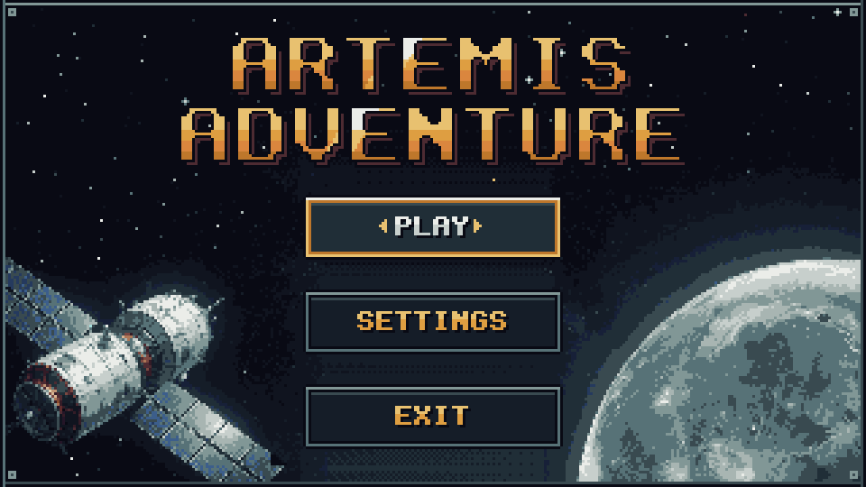

</div>

---

## Table of contents

1. [The idea](#the-idea)
2. [How a mission works](#how-a-mission-works)
3. [Choosing the landing site](#choosing-the-landing-site)
4. [The base and its 15 minigames](#the-base-and-its-15-minigames)
5. [Learning while playing: tutorial and room cards](#learning-while-playing-tutorial-and-room-cards)
6. [Space weather and emergencies](#space-weather-and-emergencies)
7. [The mission report](#the-mission-report)
8. [NASA data and scientific sources](#nasa-data-and-scientific-sources)
9. [How to play](#how-to-play)
10. [Controls](#controls)
11. [Under the hood](#under-the-hood)
12. [Project structure](#project-structure)
13. [Team and credits](#team-and-credits)
14. [Use of Super Intelligence (SI) / AI tools](#use-of-super-intelligence-si--ai-tools)

---

## The idea

You are a junior astronaut of the **Artemis program**, sent to keep a small lunar outpost alive for **5 days**.
The base has five modules connected by pressurized tunnels, and everything is slowly running out:
**power, oxygen, food and the crew's health**.

The central rule: **you can never do everything.** Each day you have only **2 actions**. Every task helps one part
of the base, and every task you skip has a cost that shows up later. At the end, a mission report explains how your
decisions led to the result.

Along the way, the player learns real facts about how astronauts live and work in space. Every minigame, every room
and the final report carry a short scientific fact with its NASA (or ESA) source, and the solar storm of each
mission is modeled on a **real space weather event from the NASA DONKI database**.

**Who it is for:** anyone curious about space, especially students. A full mission takes about 10 minutes, needs no
internet connection and explains every rule in the game itself.

---

## How a mission works

```
 Title screen ──> Mission briefing ──> Choose the landing site
                                              │
          ┌───────────────────────────────────┘
          ▼
   ┌─ Morning bulletin (today's tasks, costs and gains, warnings)
   │        │
   │        ▼
   │  Walk through the base ──> pick a task ──> tutorial card (first time) ──> minigame
   │        │                                                        │
   │        │      (solar storm alarm / meteor shower may interrupt) ◄┘
   │        ▼
   │  2 actions used ──> go to bed ──> night summary (consumption, lunar night, damage)
   │        │
   └────────┘  next day (5 days in total)
            │
            ▼
   Mission report: COMPLETE · WITH DIFFICULTIES · ABORTED
```

### The four indicators

| Indicator | What it means | How it changes |
|---|---|---|
| **POWER** | Electricity for the whole base | Spent every night (-16). Solar panels add power only during the lunar day. Batteries and the power grid work at night. |
| **OXYGEN** | Breathable air | Spent every night (-16). Recovered by the air console, the CO2 filter, the algae and water. |
| **FOOD** | Supplies and the greenhouse | Spent every night (-10). Recovered by the greenhouse and the algae. |
| **HEALTH** | The crew's condition | Drops when any resource is low (below 25) at night, in solar storms and in emergencies. Recovered by meals, the decontamination shower, the greenhouse and the medical check. |

If any resource reaches **zero**, the mission is **aborted**. Finishing day 5 with every resource above the low
limit means **MISSION COMPLETE**; finishing with something low means **WITH DIFFICULTIES**.

### The morning bulletin

Every day starts with a message from mission control: the tasks offered today, what each one **costs and gives**,
and any warning, such as a lunar night or a solar storm coming tomorrow.

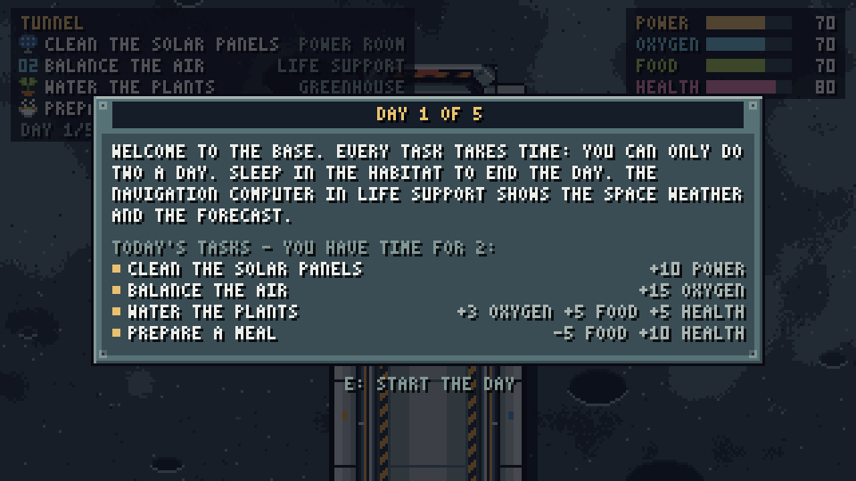

### Walking through the base

The base is seen from above. The top-left list shows today's tasks, done tasks get a green check, and the minimap
in the corner shows where each one is. The current values of the four indicators stay in the top-right corner. A
"+15" appears next to an indicator whenever a task changes it.

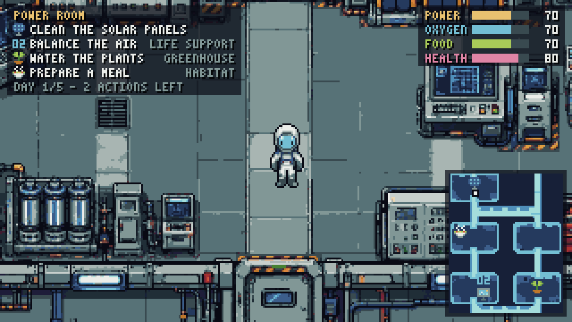

When the 2 actions of the day are used, a yellow arrow points to the bunk in the Habitat, and the minimap shows only
the bed and the navigation computer.

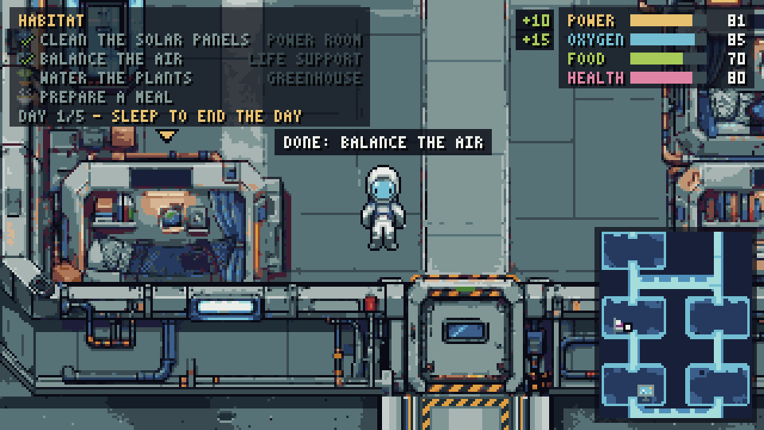

---

## Choosing the landing site

Before landing, the player picks one of three sites inspired by the real Artemis candidate regions near the lunar
south pole. The choice changes the starting resources, how much the solar panels produce and how long the lunar
night lasts. **No site wins by itself**: each one trades one problem for another.

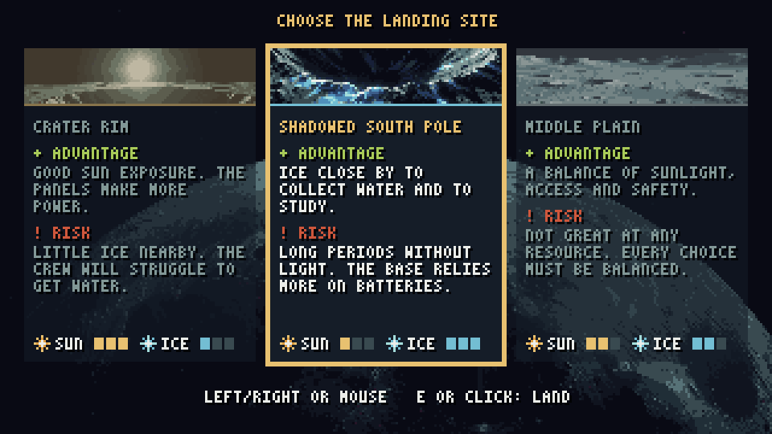

| Site | Advantage | Risk | Start (power / O2 / food / health) | Solar output | Lunar night |
|---|---|---|---|---|---|
| **Crater rim** | Good sun exposure: the panels make more power. | Little ice nearby: water is hard to get. | 75 / 65 / 70 / 80 | 100% | 1 day (from day 3) |
| **Shadowed south pole** | Ice close by, to collect water and to study. | Long periods without light: the base relies on batteries. | 60 / 75 / 70 / 80 | 70% | 3 days (from day 2) |
| **Middle plain** | A balance of sunlight, access and safety. | Not great at any resource: every choice must be balanced. | 70 / 70 / 70 / 80 | 85% | 2 days (from day 3) |

---

## The base and its 15 minigames

The outpost has five modules: **Power Room, Habitat, Life Support, Greenhouse and Shielded Shelter**. Each task opens
a short minigame of about 5 to 40 seconds. Every minigame is drawn in the same pixel-art style and fits in a
320x180 panel.

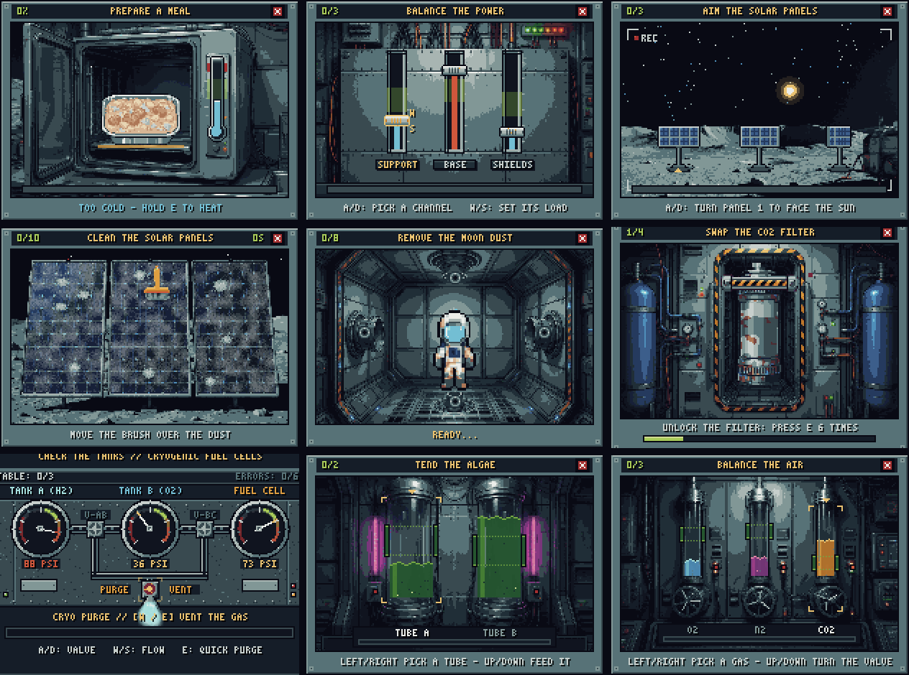

| Room | Task | What you do | Effect |
|---|---|---|---|
| Power Room | **Clean the solar panels** | Move a brush over the moon dust on 3 panels. The longer it takes, the less power the panels give. | +12 POWER × solar output |
| Power Room | **Calibrate the batteries** | Stop a swinging needle inside the green zone. It gets faster on each battery. | +15 POWER |
| Power Room | **Aim the solar panels** | Turn 3 panels to face the low Sun and hold them until they lock. | +10 POWER × solar output |
| Power Room | **Balance the power** | Bring 3 coupled power channels into the green at the same time. Raising one pushes the others down. | +10 POWER |
| Power Room | **Check the tanks** | Use crossfeed valves and a purge to bring 3 cryogenic tanks into a safe pressure. | +5 OXYGEN |
| Life Support | **Balance the air** | Keep O2, N2 and CO2 in their green bands while they drift on their own. | +15 OXYGEN |
| Life Support | **Swap the CO2 filter** | Unlock, pull out the old cartridge, slide in the new one and lock it. | +10 OXYGEN |
| Life Support | **Tend the algae** | Dose nutrients and light so that 2 spirulina tubes stay in their band. | +5 OXYGEN, +3 FOOD |
| Habitat | **Prepare a meal** | Hold to heat and release to cool. Keep the food at the right temperature; above the red mark it burns. | +10 HEALTH, -5 FOOD |
| Habitat | **Refill the water** | Open the tap and stop it on the green mark without spilling. | +8 OXYGEN × ice nearby |
| Habitat | **Remove the moon dust** | Press the direction of each air jet in the decontamination booth as it lights up. | +8 HEALTH |
| Habitat | **Check the crew vitals** | Match the amplitude and heart rate of an ECG wave. Only offered the day after a solar storm. | +10 HEALTH |
| Greenhouse | **Water the plants** | Keep a moving drop inside the water jet so the lettuce grows. | +5 FOOD, +5 HEALTH, +3 OXYGEN |
| Greenhouse | **Fix the irrigation** | Rotate pipe pieces to lead water from the tank to 3 beds, with limited turns. | +5 FOOD |
| Shielded Shelter | **Reinforce the shielding** | Slide heavy plates with inertia over the leaks and bolt them. | +1 shield reinforcement |

**Mistakes matter, but they are fair.** Each minigame counts the player's mistakes:

- **Up to 20% wrong moves:** the task gives everything.
- **Above that:** the gain drops in a straight line, down to zero at 100% wrong moves. Costs are always paid in full.
- **Too many mistakes:** in the minigames that can fail, the task is lost. The day's action is spent and nothing is
  gained.
- **Leaving a minigame:** closing it before starting is free. Closing it after starting asks for confirmation and
  counts as a failure, so the player cannot escape a bad result by reopening the task.

---

## Learning while playing: tutorial and room cards

**Tutorial card.** The first time a task is played in a mission, a card shows an illustration, how to play (with
the keys drawn as keyboard keys) and a **REAL FACT** that explains why astronauts do this for real, with its source.

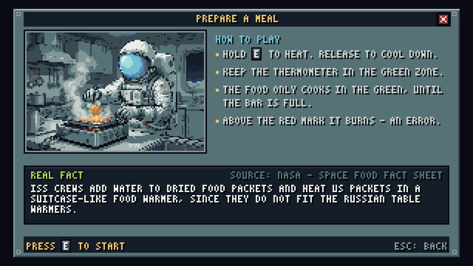

**Room card.** The first time the player enters each module, a card explains what that room is for, lists the tasks
done there and shows a scientific fact about it.

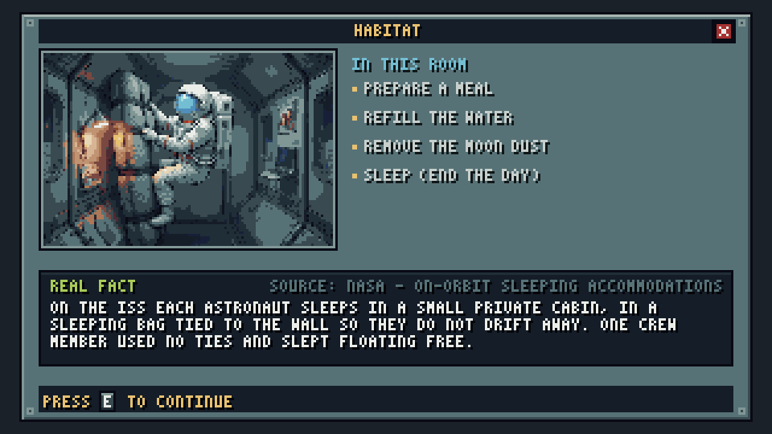

Cards return in every new mission, so a new player on the same computer sees all of them again. They can also be
shown again from the pause menu (**Options → Show tutorials again**).

---

## Space weather and emergencies

### Solar storm (based on NASA DONKI)

In every mission, a solar eruption happens on a random day between day 2 and day 4. The bulletin of the day before
warns about it. After the 1st or the 2nd task of that day (the player never knows which), the alarm rings: **the
player has 18 seconds to reach the Shielded Shelter.**

- **Inside the shelter**, the crew loses only 5 HEALTH.
- **Caught outside**, they lose up to 50 HEALTH. Each shield reinforcement done in the previous days reduces this by
  20 (minimum 10).

Every storm is modeled on a **real event recorded in the NASA DONKI database**, named on the alarm screen and
explained in the final report.

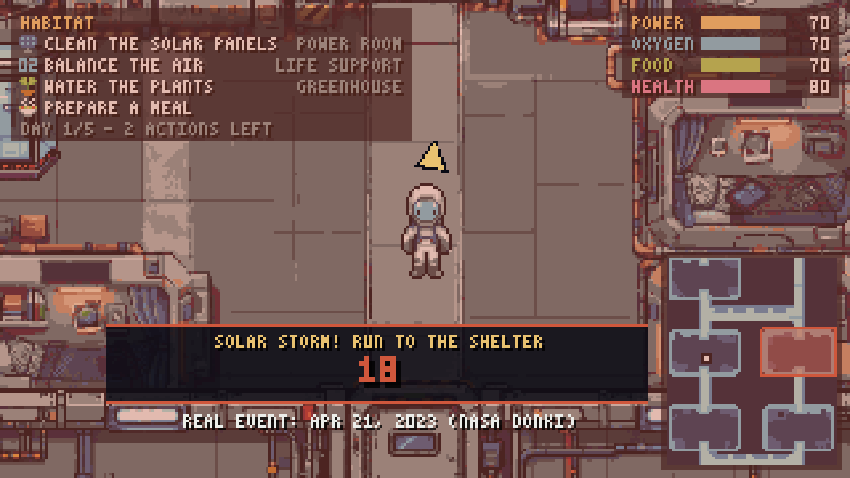

### Meteor shower

Once per mission, never on a lunar night nor on the storm day, a meteor shower targets a random module. A siren
sounds, the module blinks on the minimap and the player has **25 seconds** to pull the emergency lever in that room.
If the time runs out, the module is hit, the screen shakes and the base loses resources and health.

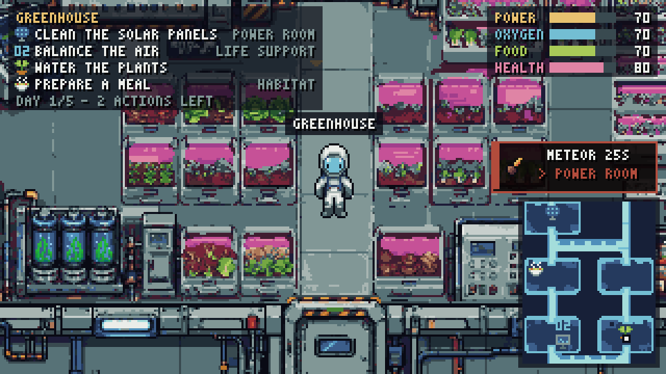

### Navigation computer

A computer in Life Support shows four windows: **space weather**, the **mission log**, the **forecast** for the next
days (including the lunar night and solar risk) and the **base status**. It also lets the player browse the archived
NASA DONKI events used by the game. Reading it does not spend an action. A blue arrow marks it when there is a new
forecast.

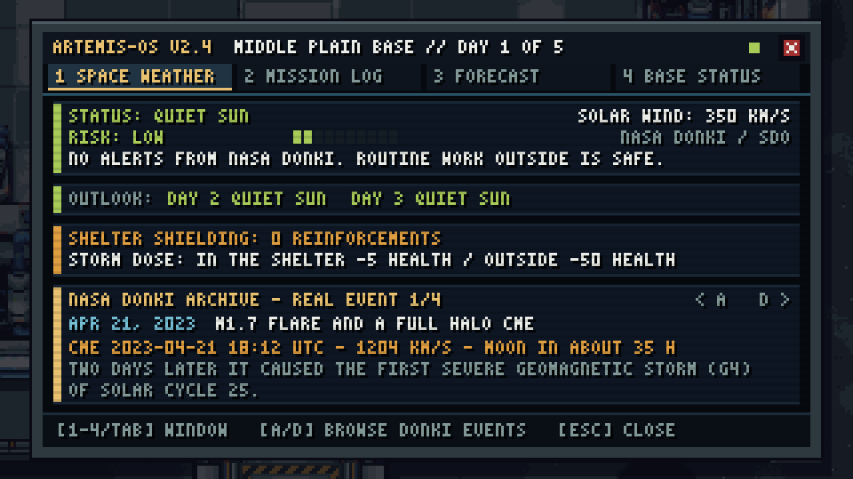

---

## The mission report

At the end, a three-page report tells the story of the mission:

1. **Overview:** the final status (complete, with difficulties or aborted), a short story of why, the landing site
   and the final values of the four indicators.
2. **Log:** a timeline of the most important moments: landing, lunar nights, storms, critical resources. It also
   names the decision that had the most impact and its trade-off.
3. **DONKI:** the real NASA space weather event that the mission's storm was modeled on, and a scientific fact
   related to the player's biggest decision.

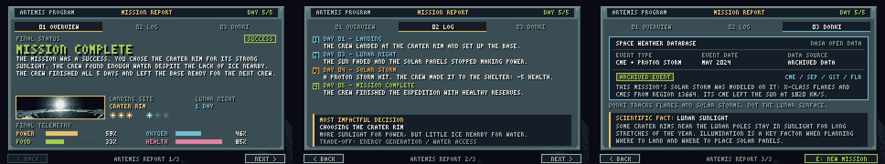

---

## NASA data and scientific sources

The game runs **fully offline**. All data is stored in JSON files inside the project (`jogo/dados/`).

### NASA DONKI (Space Weather Database Of Notifications, Knowledge, Information)

The solar storm of each mission is drawn from four real events. They were checked through the DONKI API at
[api.nasa.gov](https://api.nasa.gov/) (CME Analysis, most accurate only) and saved in `jogo/dados/eventos_solares.json`.

| Date | Event | CME (DONKI) | Speed | Why it matters |
|---|---|---|---|---|
| Apr 21, 2023 | M1.7 flare and a full halo CME | 2023-04-21T18:12Z | 1204 km/s | Two days later it caused the first severe (G4) geomagnetic storm of solar cycle 25. |
| May 2024 | X-class flares and CMEs from region 13664 | 2024-05-11T01:36Z | 1820 km/s | The "Gannon storm", the strongest geomagnetic storm on Earth since 2003. |
| Sep 10, 2017 | X8.2 flare and proton storm | 2017-09-10T16:09Z | 2650 km/s | Its particles were strong enough to be measured on the ground (GLE 72). |
| Oct 28, 2021 | X1.0 flare and proton storm | 2021-10-28T15:53Z | 1109 km/s | The first ground level event of solar cycle 25 (GLE 73). |

### Real facts in the game

Each tutorial card and each room card shows one fact with its source:

| In the game | Topic | Source |
|---|---|---|
| Refill the water | The ISS recovers 98% of its water | [NASA](https://www.nasa.gov/missions/station/iss-research/nasa-achieves-water-recovery-milestone-on-international-space-station/) |
| Tend the algae | Spirulina grown on the ISS (MELiSSA) | [ESA](https://www.esa.int/Science_Exploration/Human_and_Robotic_Exploration/Research/Green_smoothies_in_space) |
| Aim the solar panels | Vertical solar arrays for the lunar poles | [NASA](https://www.nasa.gov/technology/nasa-industry-to-mature-vertical-solar-array-technologies-for-lunar-surface/) |
| Reinforce the shielding | The Orion radiation shelter | [NASA](https://www.nasa.gov/missions/artemis/orion/scientists-and-engineers-evaluate-orion-radiation-protection-plan/) |
| Calibrate the batteries / Balance the power | The ISS electric power system | [NASA NTRS](https://ntrs.nasa.gov/api/citations/20000063506/downloads/20000063506.pdf) |
| Remove the moon dust | Apollo 17 and "lunar hay fever" | [NASA](https://www.nasa.gov/technology/tech-transfer-spinoffs/measuring-moon-dust-to-fight-air-pollution-2/) |
| Water the plants | The Veggie plant growth system on the ISS | [NASA](https://www.nasa.gov/missions/station/veggie-plant-growth-system-activated-on-international-space-station/) |
| Balance the air | CO2 on the ISS and crew headaches | [NASA](https://www.nasa.gov/wp-content/uploads/2023/12/ochmo-tb-004-carbon-dioxide.pdf) |
| Clean the solar panels | Dust and the end of the InSight mission | [NASA](https://www.nasa.gov/missions/insight/nasa-retires-insight-mars-lander-mission-after-years-of-science/) |
| Prepare a meal | How ISS crews prepare food | [NASA](https://www.nasa.gov/wp-content/uploads/2015/05/167750main_fs_spacefood508c.pdf) |
| Swap the CO2 filter / Check the tanks | Apollo 13 | [NASA](https://www.nasa.gov/history/houston-weve-had-a-problem/) |
| Fix the irrigation | XROOTS: plants without soil | [NASA](https://science.nasa.gov/biological-physical/investigations/xroots/) |
| Check the crew vitals | Artemis I radiation mannequins | [NASA](https://www.nasa.gov/general/artemis-i-space-radiation-research-to-help-moon-mars-explorers/) |
| Habitat (room card) | Sleeping on the ISS | [NASA NTRS](https://ntrs.nasa.gov/api/citations/20190027189/downloads/20190027189.pdf) |
| Power Room (room card) | Fission Surface Power for the Moon | [NASA](https://www.nasa.gov/exploration-systems-development-mission-directorate/fission-surface-power/) |
| Life Support (room card) | Electrolysis and the Sabatier reactor | [NASA](https://www.nasa.gov/wp-content/uploads/2020/10/g-281237_eclss_0.pdf) |
| Greenhouse (room card) | Plants grown in Apollo lunar soil | [NASA](https://www.nasa.gov/humans-in-space/scientists-grow-plants-in-lunar-soil/) |
| Shielded Shelter (room card) | Cosmic ray light flashes seen by Apollo crews | [NASA](https://www.nasa.gov/history/afj/ap17fj/10_day04_part2_light_flash.html) |

The final report adds one more fact, chosen by the player's most impactful decision, such as water ice at the poles,
lunar sunlight, surviving the lunar night, life support, growing food or crew health (`jogo/dados/curiosidades.json`).

---

## How to play

### Run from source

1. Install **[Godot 4.5](https://godotengine.org/download/)**, the standard version (no .NET needed). The project
   was tested with Godot 4.5.1.
2. Clone this repository:
   ```
   git clone https://github.com/HattoriLoL/Artemis-Adventure.git
   ```
3. In Godot, choose **Import** and select `jogo/project.godot`.
4. Press **F5** (Run Project). The game starts on the title screen.

No internet connection, account or extra download is needed.

### Tips for a first mission

- Read the **morning bulletin**: it shows what each task costs and gives today.
- Look at the **lowest indicator** before choosing. A resource below 25 at night hurts the crew's health.
- On the **shadowed south pole** the panels give little power: the batteries and the power grid are your friends.
- Do the **shielding** before the storm. When the alarm rings, **run (Shift) to the Shielded Shelter**.
- The **navigation computer** shows the forecast. Reading it is free.

---

## Controls

| Key | Action |
|---|---|
| **W A S D** / arrows | Walk, and control the minigames |
| **Shift** | Run |
| **E** / Enter / X / J | Use a task, interact, confirm |
| **Esc** | Pause menu / leave a minigame before starting / back |
| **F11** | Toggle fullscreen |
| **Mouse** | Menus, landing site, report and the X button of each panel |

In the mission briefing, **E** skips and **holding up or down** makes the text scroll slower or faster.

---

## Under the hood

- **Engine:** Godot 4.5, GDScript only, with no plugins or external libraries.
- **Resolution:** 320x180 internal pixels, scaled by whole numbers so the pixels stay sharp.
- **Art:** built on a single 46-color "Apollo" palette. The HUD, panels, minigame interfaces, report and
  menus are drawn in code with a custom 3x5 pixel font (`scripts/fonte.gd`), so the text is always crisp.
- **Data-driven design:** rooms, tasks, days, resources, landing sites, tutorials, facts and DONKI events live in
  JSON files. Changing the balance, or adding a task to a day, needs no code change.
  - `jogo/salas/<room>.json`: walls, doors, tasks and interactions of each room.
  - `jogo/dados/dias.json`: tasks and bulletin of each day.
  - `jogo/dados/recursos.json`: daily consumption, task effects, storm and error rules.
  - `jogo/dados/locais_pouso.json`: the three landing sites.
  - `jogo/dados/tutoriais.json`, `salas_fatos.json` and `curiosidades.json`: learning content.
  - `jogo/dados/eventos_solares.json`: the NASA DONKI events.
- **Pressurized doors:** before opening, each door equalizes the pressure on both sides, with an amber light and a
  hiss.
- **One minigame contract:** every minigame is a 320x180 `Control` with the signals `terminou` (done), `falhou`
  (failed) and `cancelou` (closed), plus an optional `taxa_erro()` (error rate). The map opens any minigame the same
  way.
- **Balancing:** the economy was tuned with automated bots. They play hundreds of missions with different player
  profiles (careful, average, random, reckless) on every landing site. A careful player completes about 9 of 10
  missions, and an average player always survives, though often with difficulties.
- **Offline and safe to share:** no network calls and no accounts. Developer tools (the DEV tab in the pause menu
  and the F12 screenshot key) only exist when the game runs from the Godot editor.

---

## Project structure

```
jogo/                         the Godot project (open project.godot)
  project.godot
  cenas/                      scenes: title screen, briefing, landing site, map and the 15 minigames
  scripts/                    all game code (GDScript)
    mapa.gd                   the base: rooms, doors, tasks, HUD, minimap, minigames
    ciclo_dias.gd             days, actions, bulletin, night summary, end of mission
    recursos.gd               the four indicators and the task effects
    missao.gd                 mission state shared between scenes (autoload "Missao")
    tempestade.gd             solar storm alarm and shelter
    emergencia_meteoros.gd    meteor shower emergency
    relatorio.gd              the final mission report
    computador_navegacao.gd   navigation computer (space weather, log, forecast, status)
    tutorial_minigame.gd      tutorial cards
    card_sala.gd              room cards
    minigame_*.gd             one script per minigame
  dados/                      game data (JSON): days, resources, sites, tutorials, facts, DONKI events
  salas/                      the five rooms (JSON + tile scenes)
  mapa/                       the base map (positions, tunnels, doors)
  assets/                     art and sound
docs/images/                  screenshots used in this README
```

---

## Team and credits

Built by a small team during the NASA International Space Apps Challenge 2026.

| Member | Main contributions |
|---|---|
| [HattoriLoL](https://github.com/HattoriLoL) | Project lead, game design, art direction and most of the programming: base map, pressurized doors, mission cycle, resources and balancing, solar storm, tutorial and room cards, minigame integration, HUD and minimap. |
| [DKuhn29](https://github.com/DKuhn29) | Final mission report, first title screen, music, and the irrigation, crew vitals and solar panel cleaning minigames. |
| [IltonBJSilva](https://github.com/IltonBJSilva) | Meteor shower emergency with wall levers, the cryogenic tanks minigame, the navigation computer with NASA DONKI events, and the original ideas for the shielding, meal and power balance minigames. |
| [chinesdecroks](https://github.com/chinesdecroks) | The solar panel aiming, battery calibration and decontamination shower minigames. |

**Thanks to** NASA for the open data (DONKI, NTRS and the many public articles cited above), and to ESA for the
MELiSSA spirulina research.

This project is not affiliated with or endorsed by NASA.

---

## Use of Super Intelligence (SI) / AI tools

In compliance with the **NASA International Space Apps Challenge Super Intelligence (SI) Policy**, this section transparently describes where and how AI/SI tools were used to accelerate development and quality assurance:

### Summary of SI Tool Usage

| Category | SI Used? | Description & Disclosure |
|---|---|---|
| **Code & Programming** | **Yes** | LLM assistance (Google Antigravity / Gemini) was utilized to accelerate GDScript refactoring, automated QA unit test generation (`jogo/tests/`), mobile touch input architecture (`virtual_dpad.gd`, `touch_overlay.gd`, `mobile_manager.gd`), and continuous integration / export pipeline configuration. All core gameplay architecture, minigame mechanics, and state machines were designed, reviewed, and finalized by team developers. |
| **Data & Scientific Curation** | **Yes** | LLM assistance was utilized to parse, summarize, and structure scientific references from public NASA open data (DONKI space weather catalogs, NASA Technical Reports Server - NTRS, and ESA MELiSSA publications) into structured JSON data files (`jogo/dados/`). |
| **Images & Video** | **No** | All in-game pixel art, sprites, tilesets, UI elements, and promotional captures were hand-crafted by human team members using pixel art editors and procedural GDScript shaders adhering to the custom 46-color Apollo palette. No AI image generation or video synthesis models were used for visual assets. |
| **Audio & Music** | **No** | In-game sound effects, alarms, ambient soundscapes, and opening music were composed and produced directly by human team members with synthesizers and digital audio workstations. |

### NASA Branding & Compliance Notice
In strict accordance with NASA Space Apps regulations, no generated content contains, modifies, or misrepresents official NASA logos, flags, seals, or mission identifiers. All educational references to NASA, DONKI, and the Artemis program are informational citations of publicly available scientific data.
